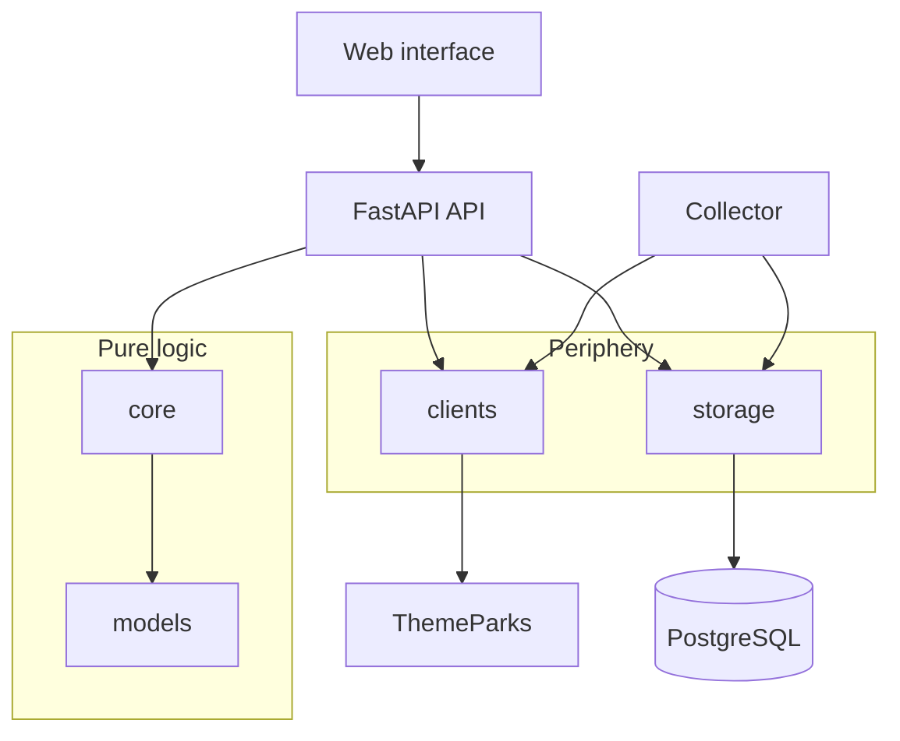

## Problem

In a theme park, the shortest line is not always the best choice. If it is 5 minutes long but 900 meters away, the visitor walks 15 minutes to save 10.

Lines also change quickly, and anyone who does not keep up makes poor decisions all day. That is why an informal service appeared: a consultant watches a wait-times website and messages the client on WhatsApp. It is a person running an algorithm in real time. NextUp is that algorithm.

## Solution

The ranking uses a single formula: `total_cost = walking_time + waiting_time`. A 10-minute line 900 meters away loses to a 20-minute line 50 meters away, and a test locks this rule in. Every recommendation shows the math, because a suggestion without a reason does not build trust.

The screen opens with the park map and the "Your next move" card. GPS follows the visitor, the ranking is recalculated every 25 meters and wait times refresh every 2 minutes. Anyone who denies GPS access can tap the map to mark where they are.

Two optional questions set the profile: the height of the shortest child and a preference for calm or thrill rides. The heights and labels of all 35 rides were checked by hand against the official listing. Everything stays on the phone, with no sign-up.

The data comes live from the public ThemeParks.wiki API. Since October 28, 2026, the first version shows only Magic Kingdom.

**In development:** an LLM assistant that answers natural-language questions, using *tool calling* on the recommendation API itself.

**Under investigation:** a full-day itinerary. The exact optimizer already exists, but it has no screen yet. That depends on measurement proving it is worth it.

**Method:** I built it with Claude Code, with versioned context in [`CLAUDE.md`](https://github.com/GabrielFDA7/nextup/blob/main/CLAUDE.md), custom skills in [`.claude/skills/`](https://github.com/GabrielFDA7/nextup/tree/main/.claude/skills) and selected prompts in [`docs/PROMPTS.md`](https://github.com/GabrielFDA7/nextup/blob/main/docs/PROMPTS.md).

## Architecture

**The rule is the direction of dependencies.** The `core`, where the ranking lives, receives ready-made objects and does not know where they came from. Only the periphery talks to the network and the database: `clients` fetches wait times from ThemeParks.wiki, with a cache, and `storage` keeps the history in PostgreSQL. That is why the algorithm tests run offline, in milliseconds, without depending on the API being up or the park being open.

**The rule is tested, not just documented.** `test_arquitetura.py` reads the syntax tree of each module, without running it, and fails if `core` or `models` import `httpx`, `sqlalchemy` or the periphery layers.

**Two paths to the data.** The API answers whoever is in the park. The collector records wait times even when nobody is using the site, because without history there is no trend. A failure at the source does not bring the collector down: it stays alive for when the source comes back.

## Technical decisions

**Ranking by total cost, not by the shortest line.** This is the product's thesis. The price is requiring the coordinates of every ride and the visitor's position.

**Wait-time forecasting dropped after measurement.** Over the span of a walk, the source's own forecast is off by 9.52 minutes, against 2.03 for simply using the current wait. The gain would be a more sophisticated ranking, and the cost, worse recommendations. It was left out.

**Personalization in the browser, no account.** Requiring sign-up from someone asking "where do I go now" would kill the product. The cost is that the data does not travel between devices.

**SQLite in development, PostgreSQL in production.** Anyone who clones the repository runs the tests without installing a database. The cost is that behavior may differ between the two, so there are tests for time zones and uniqueness.

**External ping to keep the collector awake.** Render's free plan sleeps without traffic, and the collector sleeps with it. GitHub Actions scheduling seemed to solve it and was always green, but measurement showed 244 runs in 37 days, when there should have been about 5,300. Today the main ping is external, and Actions is the backup. The cost is depending on one more service.

## What I learned

**Check the data, not the dashboard.** Between September 22 and October 27, 2026, the collector recorded 7 to 23 cycles a day, against about 156 expected. The job that should have kept it awake showed 100% success: it was not failing, it was just not running. Today, collection health is checked in the database.

**A single-case fixture hides bugs.** All test data came from Magic Kingdom, where every ride has coordinates. A bug made Disneyland Paris unreachable and survived 261 tests. It only showed up when I opened the app and clicked.
