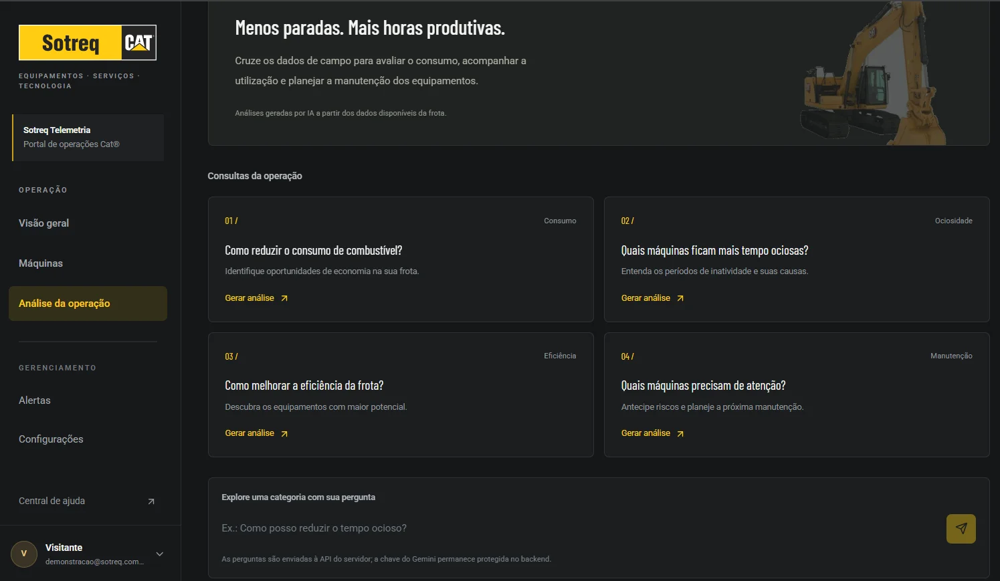
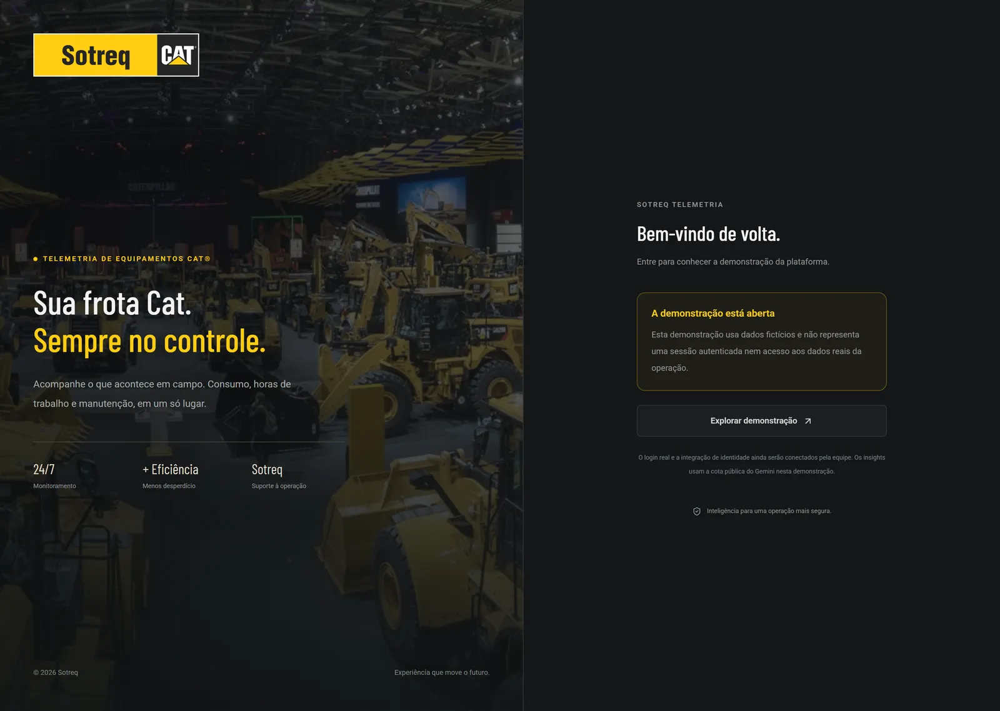
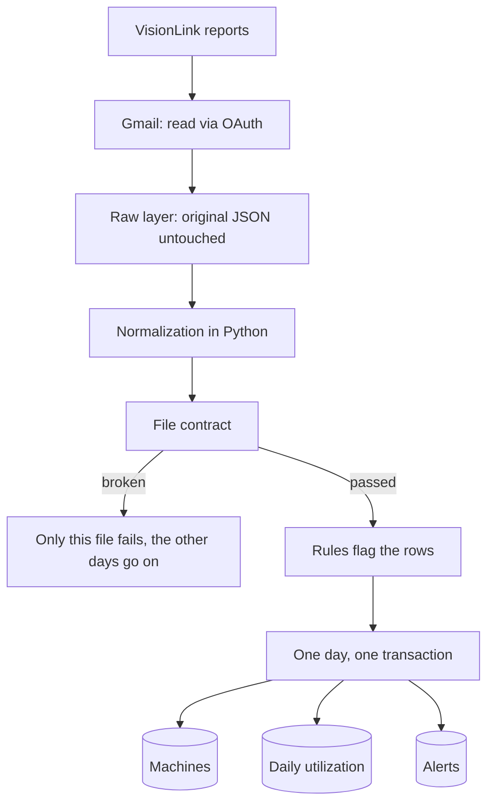

## Problem

A client with a mixed fleet, of Caterpillar and other brands, has no single view of fuel consumption, idle time and machine movement. The data sits on one website per manufacturer, and tracking the fleet means opening them one by one.

## Solution

A web application in React and Vite that consolidates the telemetry. Scheduled VisionLink reports arrive every day at a dedicated email address, and a Python pipeline reads, standardizes, validates and writes them to a PostgreSQL database on Supabase. The application reads the database, and the Gemini API returns insights on what to improve in the fleet.

**My part:** the data pipeline, from extraction to the daily write to the database, including normalization and quality.

**Dashboard analyses:** I defined the 10 analyses the dashboard shows, from idle time and the cost of idle fuel to upcoming services. For each one, I wrote the rule, the source and the chart, and checked the math against real data in pandas and in an HTML prototype, which serves as the reference for whoever builds the screens. Two rules apply to all of them: empty is not zero, because an empty hour means the data did not arrive, and a group's percentage is calculated by summing before dividing, never by averaging percentages.

**Gemini integration:** as the squad mentor, I came up with the idea and followed each step closely. The implementation was done by another team member, under my mentoring.

Analysis screen with Gemini, implemented by another team member under my mentoring. Demo with fictitious data. The interface is in Portuguese.

Demo login screen, which states on the screen itself that the data is fictitious.

## Architecture

The diagram shows the pipeline, which is my part. The tables live in Supabase's PostgreSQL. The views that calculate the indicators and the web application with Gemini belong to other team members.

**The original data is never changed.** Since the raw layer keeps the JSON exactly as it arrived, any day can be reprocessed when a rule changes.

## Technical decisions

**Ingestion by scheduled email instead of an API.** Access to the manufacturers' APIs is hard to get and was not available. The scheduled report solves data input without depending on that access. The cost is being tied to the format and frequency of the reports.

**Writing ready before the database existed.** Waiting for the tables would have stalled collection, and a day not collected is lost history. The pipeline wrote to Parquet, which keeps each column's type, while the PostgreSQL writer was built behind the same interface. When the database was ready, the switch was one environment variable, and the whole history went in on the first load. The cost was writing that code without a real database to test against.

**Reprocessing the history on every run.** Writing a day replaces that day's file, so running twice gives the same result as running once. That way, a new rule fixes the whole past. The cost is that run time grows with the history.

**A parked machine is not a silent device.** On the first database load, a no-reading alert fired 238 times in 45 days, and 186 of those were parked machines with a working device. The alert now checks the device status, and the dashboard shows the two cases under different names: a parked machine is available with no work, and a silent one needs someone to check the device. The cost is that the alert depends on a text that comes in the VisionLink account's language.

**A contract for the file, a rule for the row.** A format problem, such as a wrong time unit or a duplicate key, rejects the whole file without affecting the other days. An odd value discards nothing: the row is written and flagged. The flag has three values, because "empty" means there was not enough data to compare, which is different from "correct". The cost is that whoever analyzes the data has to take the flags into account.

**Zero cost as a requirement.** The solution had to work with no infrastructure spending.

**Built to be replicated.** The structure was designed to serve other clients, not just this one.

## What I learned

**The full path of a pipeline.** I went through extraction, understanding the data, normalization, quality and analysis.

**Using AI to learn, not to copy.** I started with a rule: the AI explained, and I wrote the code. That is how I built the report reading and the normalization. At the end, with a tight deadline, I made an exception and the AI wrote the rest, with each decision documented.

**Working on separate fronts.** It was my first group project with a clear division of work.
