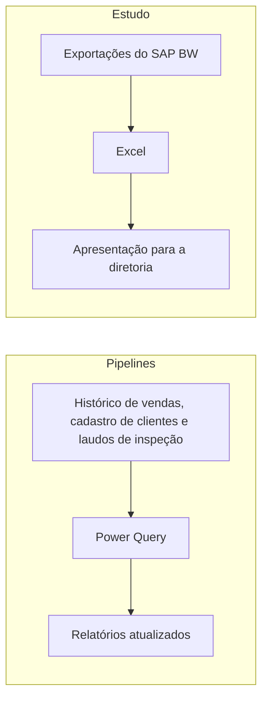

## Problema

<!-- PREENCHER: qual pergunta de negócio motivou o estudo e quem precisava da resposta -->

## Solução

**Estudo de eficiência entre filiais.** Um estudo plurianual com exportações do SAP BW, sobre DOL, Receita Líquida e a relação DOL/RL, entregue em Excel e em apresentação para a diretoria.

**Pipelines em Power Query (jan–jun/2026).** Limpam, normalizam e cruzam históricos de vendas, cadastro de clientes e laudos de inspeção, atualizando os relatórios sem intervenção manual.

## Arquitetura

## Decisões técnicas

<!-- PREENCHER: 2 a 4 escolhas, com o trade-off de cada uma -->

## Resultados

<!-- PREENCHER: resultado sem nenhum valor financeiro real, como anos cobertos ou horas economizadas -->

## O que eu aprendi

<!-- PREENCHER: o que eu aprendi ou faria diferente -->
