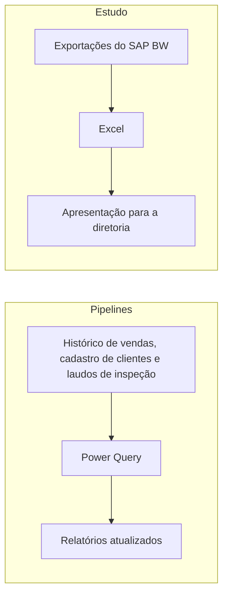

## Problema

A pergunta veio da diretoria: onde a operação poderia ficar mais eficiente sem reduzir a equipe?

## Solução

**Estudo de eficiência entre filiais (jul–ago/2026).** Um estudo plurianual com exportações do SAP BW, sobre DOL, Receita Líquida e a relação DOL/RL, entregue em Excel e em apresentação para a diretoria.

**Pipelines em Power Query (jan–jun/2026).** Limpam, normalizam e cruzam históricos de vendas, cadastro de clientes e laudos de inspeção, atualizando os relatórios sem intervenção manual.

## Arquitetura

## Decisões técnicas

**Começar em 2022.** Uma base maior traz profundidade e garante que os padrões são reais, e não algo que aconteceu em um ano só. O custo é ter mais dados para tratar e comparar.

**Pesos e métricas próprios para cada porte de filial.** Filiais de tamanhos diferentes não se comparam pelo número bruto. Por isso, usei pesos e métricas personalizadas, somados à experiência do meu gestor. O custo é a comparação depender de critério, e não de uma fórmula simples de reproduzir.

**Projeção de 2027 além da tendência.** Parti dos gastos dos anos anteriores e somei uma análise de mercado e de variáveis possíveis, como as eleições presidenciais no Brasil e as de meio de mandato nos EUA. O custo é o resultado depender dessas premissas, que precisam ser revistas quando o cenário muda.

## Resultados

- **De 2022 a 2026 analisados**, com uma projeção para o primeiro semestre de 2027.
- **Resposta entregue direto à diretoria**, em Excel e em apresentação.

## O que eu aprendi

Aprendi que se especializar em um negócio pode abrir caminho na área de desenvolvimento e análise, só por você entender muito do processo. Nem sempre é preciso estudar apenas código.
