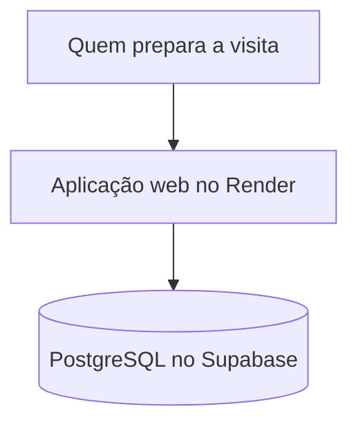

## Problema

<!-- PREENCHER: para quem é a aplicação e qual dor ela resolve -->

## Solução

Uma aplicação web que centraliza arquivos e insumos para visitas técnicas a clientes.

<!-- PREENCHER: o que a aplicação faz -->

## Arquitetura

## Decisões técnicas

<!-- PREENCHER: 2 a 4 escolhas, com o trade-off de cada uma -->

## Resultados

<!-- PREENCHER: número concreto de uso -->

## O que eu aprendi

<!-- PREENCHER: o que eu aprendi ou faria diferente -->
