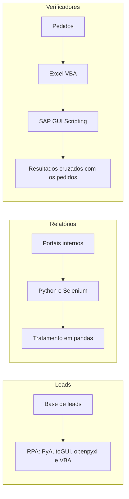

## Problema

Várias rotinas dependiam de trabalho manual repetitivo: consultas item a item no SAP, sobre a disponibilidade global de peças Caterpillar e a divergência de preços em pedidos, e a coleta de relatórios em portais internos para a base de leads.

## Solução

Três frentes no mesmo caso:

- **Verificadores em Excel VBA e SAP GUI Scripting.** Conferem disponibilidade e preços: executam as transações em lote e cruzam os resultados com os pedidos.
- **Pipelines em Python com Selenium.** Navegam, autenticam e baixam relatórios, que depois são tratados em pandas.
- **RPA do tratamento de leads.** Usa Python com PyAutoGUI e openpyxl, além de macros VBA.

## Arquitetura

## Decisões técnicas

**SAP GUI Scripting em vez de RFC ou BAPI.** O script usa a sessão do próprio operador, o que dispensa permissões diretas de RFC e BAPI. O custo é depender da interface gráfica aberta durante a execução.

## Resultados

<!-- PREENCHER: itens consultados por dia e horas economizadas -->

## O que eu aprendi

<!-- PREENCHER: o que eu aprendi ou faria diferente -->
