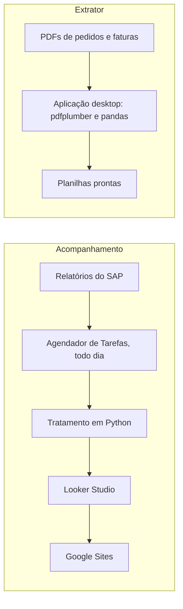

## Problema

Os dados de pedidos e faturas de um cliente chegavam em PDF e eram digitados à mão. O cliente também não tinha visibilidade do status das próprias entregas.

## Solução

**Parte 1, extrator (jan–fev/2026).** Uma aplicação desktop lê os PDFs semiestruturados de pedidos e faturas com pdfplumber, trata os dados com pandas e openpyxl e exporta planilhas prontas. A interface é em CustomTkinter, e a distribuição é um executável único, feito com PyInstaller.

**Parte 2, acompanhamento.** O Agendador de Tarefas extrai relatórios do SAP todo dia, e o Python os trata. O resultado alimenta um relatório em Looker Studio, com busca e filtros, publicado em um Google Sites.

## Arquitetura

## Decisões técnicas

**Executável único.** Assim o extrator roda nas máquinas corporativas sem instalar Python. O custo é um arquivo maior e uma nova geração do executável a cada mudança.

**Looker Studio e Google Sites.** Entregam o acompanhamento ao cliente sem custo de infraestrutura. O custo é ficar limitado ao que essas ferramentas oferecem.

## Resultados

<!-- PREENCHER: volume de documentos por mês e tempo economizado -->

## O que eu aprendi

<!-- PREENCHER: o que eu aprendi ou faria diferente -->
