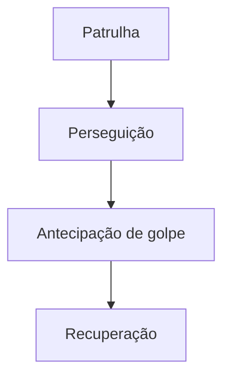

## Problema

Os inimigos precisavam de um padrão de raciocínio em combate: como atacar, quando, de qual forma e por onde.

## Solução

Um jogo de ação isométrico em Unity 6 e C#, feito em equipe na EPTA (Equipe de Propulsão e Tecnologia Aeroespacial).

**O que foi meu:** a IA dos inimigos, com uma máquina de estados de patrulha, perseguição, antecipação de golpe e recuperação, além dos ScriptableObjects e do loot.

## Arquitetura

O projeto usa scripts orientados a eventos e ScriptableObjects para separar o balanceamento (atributos, magias e probabilidades de loot) do código das entidades.

## Resultados

- **Cerca de 10 inimigos** criados.
- **Jogo em beta fechado**, com o primeiro bioma fechado e em testes.

## O que eu aprendi

Me aprofundei em C# e em orientação a objetos. Foi um dos meus primeiros projetos com programação pesada.
