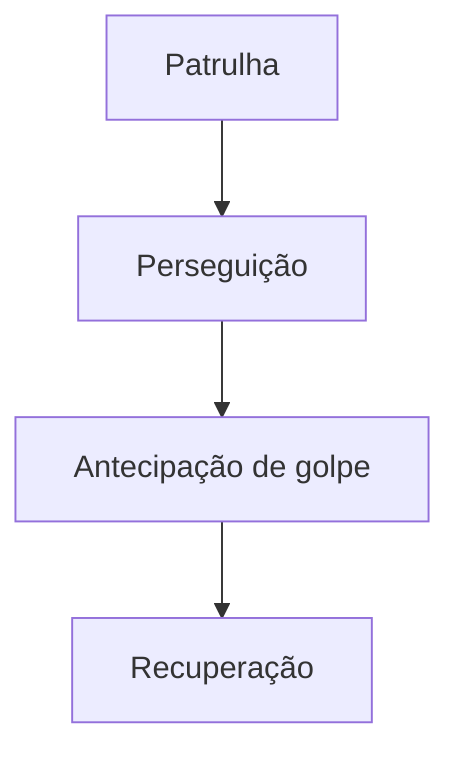

## Problema

<!-- PREENCHER: o que a IA dos inimigos precisava resolver no jogo -->

## Solução

Um jogo de ação isométrico em Unity 6 e C#, feito em equipe na EPTA (Equipe de Propulsão e Tecnologia Aeroespacial).

**O que foi meu:** a IA dos inimigos, com uma máquina de estados de patrulha, perseguição, antecipação de golpe e recuperação.

## Arquitetura

<!-- PREENCHER: conferir as transições; o diagrama mostra só a ordem dos quatro estados -->

O projeto usa scripts orientados a eventos e ScriptableObjects para separar o balanceamento (atributos, magias e probabilidades de loot) do código das entidades.

## Decisões técnicas

<!-- PREENCHER: 2 a 4 escolhas da IA dos inimigos, com o trade-off de cada uma -->

## Resultados

<!-- PREENCHER: tipos de inimigo, estado do jogo ou outro número concreto -->

## O que eu aprendi

<!-- PREENCHER: o que eu aprendi ou faria diferente -->
