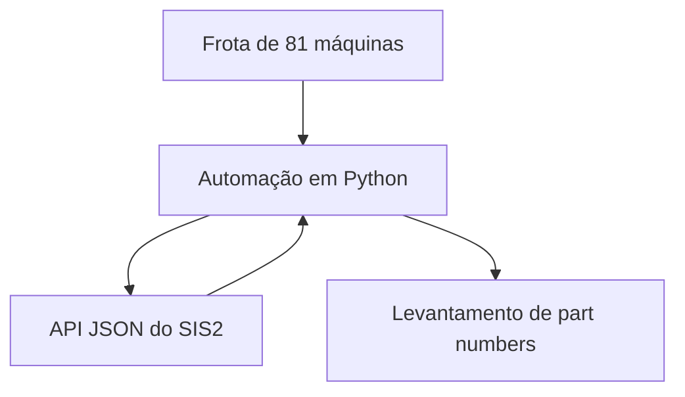

## Problema

Levantar os part numbers de uma frota de 81 máquinas exigia consulta manual, máquina a máquina, no catálogo técnico da Caterpillar.

## Solução

Uma automação em Python que consome a API JSON do SIS2 e levanta os part numbers da frota inteira.

## Arquitetura

## Decisões técnicas

**API em vez de raspagem de tela com Selenium.**

<!-- PREENCHER: por que escolhi a API e qual foi o custo dessa escolha -->

## Resultados

- 81 máquinas cobertas, sem consulta manual.

<!-- PREENCHER: tempo antes e depois -->

## O que eu aprendi

<!-- PREENCHER: o que eu aprendi ou faria diferente -->
