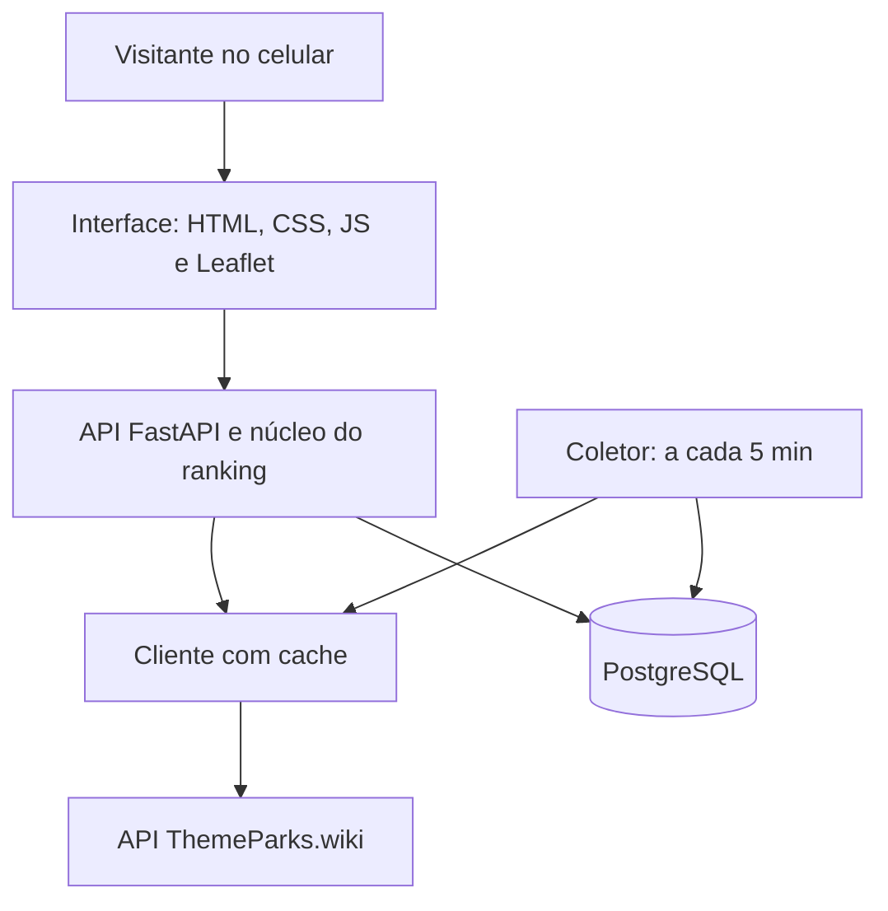

## Problema

Em um parque temático, a menor fila nem sempre é a melhor escolha. Se ela está com 5 minutos, mas fica a 900 metros, o visitante caminha 15 minutos para economizar 10.

As filas também mudam rápido, e quem não acompanha decide mal o dia inteiro. Por isso surgiu um serviço informal: um consultor monitora um site de filas e avisa o cliente por WhatsApp. É uma pessoa executando um algoritmo em tempo real. O NextUp é esse algoritmo.

## Solução

O ranking usa uma única conta: `custo_total = tempo_de_caminhada + tempo_de_fila`. Uma fila de 10 minutos a 900 metros perde para uma de 20 minutos a 50 metros, e um teste trava essa regra. Toda recomendação mostra a conta aberta, porque uma sugestão sem motivo não gera confiança.

A tela abre com o mapa do parque e o cartão "Seu próximo passo". O GPS acompanha o visitante, o ranking é refeito a cada 25 metros e as filas se renovam a cada 2 minutos. Quem nega o GPS toca no mapa para marcar onde está.

Duas perguntas opcionais definem o perfil: a altura da criança mais baixa e o gosto por atrações tranquilas ou radicais. As alturas e as etiquetas das 35 atrações foram conferidas à mão na listagem oficial. Tudo fica no próprio celular, sem cadastro.

Os dados vêm ao vivo da API pública ThemeParks.wiki. Desde 28/10/2026, a primeira versão mostra só o Magic Kingdom.

**Em desenvolvimento:** um assistente com LLM que responde perguntas em linguagem natural, usando *tool calling* sobre a própria API de recomendação.

**Em investigação:** um roteiro do dia. O otimizador exato já existe, mas ainda não tem tela. Ela depende de a medição provar que vale a pena.

**Método:** construí com Claude Code, com contexto versionado em [`CLAUDE.md`](https://github.com/GabrielFDA7/nextup/blob/main/CLAUDE.md), skills próprias em [`.claude/skills/`](https://github.com/GabrielFDA7/nextup/tree/main/.claude/skills) e todos os prompts registrados em [`docs/PROMPTS.md`](https://github.com/GabrielFDA7/nextup/blob/main/docs/PROMPTS.md).

## Arquitetura

O núcleo não importa nada de rede nem de banco, por isso seus testes rodam offline. Essa regra não vive só na documentação: `test_arquitetura.py` lê o código-fonte e falha se ela for quebrada.

## Decisões técnicas

**Ranking por custo total, não pela menor fila.** É a tese do produto. O preço é exigir as coordenadas de cada atração e a posição do visitante.

**Previsão de fila descartada por medição.** No horizonte de uma caminhada, a previsão da própria fonte erra 9,52 minutos, contra 2,03 de simplesmente usar a fila atual. O ganho seria um ranking mais sofisticado, e o custo, recomendações piores. Ficou de fora.

**Personalização no navegador, sem conta.** Exigir cadastro de quem pergunta "para onde vou agora" mataria o produto. O custo é os dados não viajarem entre aparelhos.

**SQLite no desenvolvimento, PostgreSQL em produção.** Quem clona o repositório roda os testes sem instalar banco. O custo é o comportamento poder divergir entre os dois, por isso há testes de fuso horário e de unicidade.

## Resultados

- **946 testes** automatizados: 745 na suíte rápida e 201 de interface em navegador. Nenhum toca a internet.
- **CI** em Python 3.11, 3.12 e 3.13, com lint, formatação e um job que sobe a imagem Docker e confere que ela não roda como root.
- **Deploy contínuo** no Render a cada push na branch principal.
- **Decisões medidas:** a faixa de popularidade saiu de 1.257 medições reais, com 83% de estabilidade contra 74% da alternativa.
- **Processo auditável:** 10 sessões e 70 prompts registrados na íntegra.

<!-- PREENCHER: número de usuários reais, se houver -->

## O que eu aprendi

**Confira o dado, não o painel.** Entre 22/09 e 27/10/2026, o coletor gravou de 7 a 23 ciclos por dia, contra cerca de 156 esperados. O job que deveria mantê-lo acordado mostrava 100% de sucesso: ele não falhava, só não rodava. Hoje a saúde da coleta se confere no banco.

**Fixture de um caso só esconde bug.** Todos os dados de teste eram do Magic Kingdom, onde toda atração tem coordenada. Um bug deixou o Disneyland Paris inacessível e sobreviveu a 261 testes. Só apareceu quando abri o app e cliquei.
