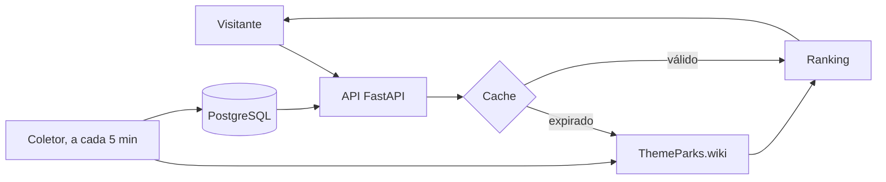

## Problema

Em um parque temático, a menor fila nem sempre é a melhor escolha, porque a caminhada até ela custa tempo. Hoje existe um serviço informal em que uma pessoa monitora as filas e avisa clientes por WhatsApp. O NextUp automatiza esse raciocínio.

## Solução

O ranking usa uma única conta: `custo_total = tempo_de_caminhada + tempo_de_fila`. Uma fila de 10 minutos a 900 metros perde para uma de 20 minutos a 50 metros, e um teste trava essa regra.

Os dados vêm ao vivo da API pública ThemeParks.wiki, a distância é calculada por Haversine e a interface mostra tudo em um mapa com Leaflet. Desde 28/10/2026, a primeira versão pública mostra só o Magic Kingdom.

**Em desenvolvimento:** um assistente com LLM que responde perguntas em linguagem natural, usando *tool calling* sobre a própria API de recomendação.

## Arquitetura

## Decisões técnicas

**Ranking por custo total, não pela menor fila.** É a tese do produto. O preço é exigir as coordenadas de cada atração.

**Previsão de fila descartada por medição.** A previsão da fonte errou 9,52 minutos contra 2,03 da fila atual, no horizonte de uma caminhada. Mais código pioraria a resposta, então a previsão ficou de fora do ranking.

**SQLite no desenvolvimento, PostgreSQL em produção.** Quem clona o repositório roda os testes sem instalar banco. O custo é o comportamento poder divergir entre os dois, por isso há testes de fuso horário e de unicidade.

**Interface sem framework.** Sem build e sem `node_modules`. O custo é manipular o DOM à mão e escrever o gráfico em SVG.

## Resultados

- 946 testes automatizados: 745 na suíte rápida e 201 de interface em navegador.
- CI em Python 3.11, 3.12 e 3.13.
- Imagem Docker sem root, com healthcheck, e deploy contínuo no Render.

## O que eu aprendi

O painel do job de coleta mostrava 100% de sucesso enquanto o coletor gravava só 7 a 23 ciclos por dia, contra cerca de 156 esperados. Hoje eu confiro o dado que chegou ao banco, não o status de quem deveria gravá-lo.
