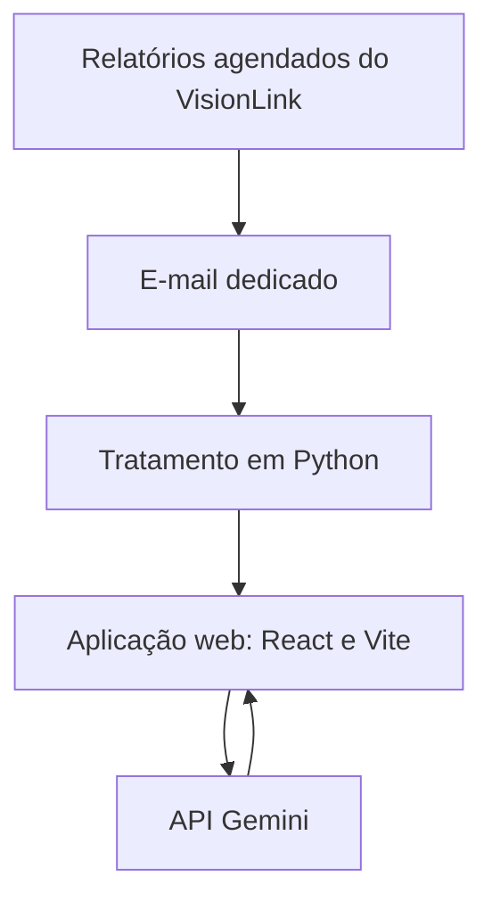

## Problema

Um cliente com frota mista, de Caterpillar e outras marcas, não tem uma visão única de consumo de combustível, ociosidade e deslocamento das máquinas.

## Solução

Uma aplicação web em React e Vite que consolida a telemetria. Os dados chegam por relatórios agendados do VisionLink em um e-mail dedicado e são tratados em Python. A aplicação envia esses dados à API do Gemini, que devolve insights sobre o que melhorar na frota.

**O que foi meu:** o pipeline de dados, da ingestão ao tratamento.

## Arquitetura

## Decisões técnicas

**Ingestão por e-mail agendado, em vez de API.** O acesso às APIs dos fabricantes é difícil e não estava disponível. O relatório agendado resolve a entrada de dados sem depender desse acesso. O custo é ficar preso ao formato e à frequência dos relatórios.

**Custo zero como requisito.** A solução precisava funcionar sem gasto de infraestrutura.

**Base pensada para replicar.** A estrutura foi desenhada para servir a outros clientes, e não só a este.

## Resultados

<!-- PREENCHER: máquinas monitoradas, relatórios processados ou outro número que possa ser público -->

## O que eu aprendi

<!-- PREENCHER: o que eu aprendi ou faria diferente -->
