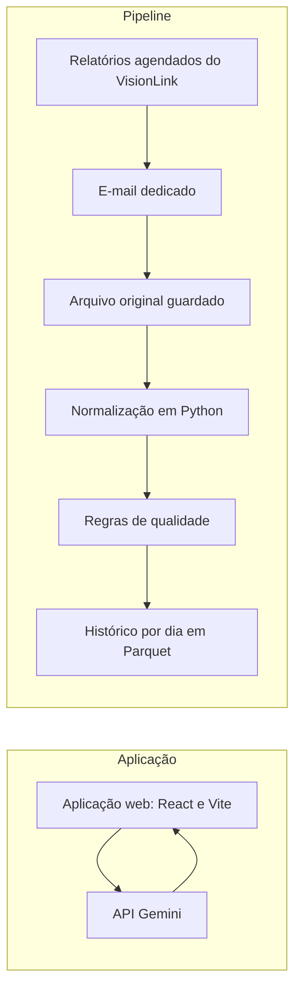

## Problema

Um cliente com frota mista, de Caterpillar e outras marcas, não tem uma visão única de consumo de combustível, ociosidade e deslocamento das máquinas. Os dados ficam em um site por fabricante, e acompanhar a frota significa abrir um por um.

## Solução

Uma aplicação web em React e Vite que consolida a telemetria. Os relatórios agendados do VisionLink chegam todo dia a um e-mail dedicado, e um pipeline em Python os lê, padroniza, valida e grava. A API do Gemini devolve insights sobre o que melhorar na frota.

**O que foi meu:** o pipeline de dados, da extração à execução diária, passando por normalização e qualidade.

## Arquitetura

## Decisões técnicas

**Ingestão por e-mail agendado, em vez de API.** O acesso às APIs dos fabricantes é difícil e não estava disponível. O relatório agendado resolve a entrada de dados sem depender desse acesso. O custo é ficar preso ao formato e à frequência dos relatórios.

**Parquet local até o banco existir.** Esperar as tabelas do banco travaria a coleta, e dia não coletado é histórico perdido. O Parquet preserva o tipo de cada coluna, ao contrário do CSV. O custo é ficar sem SQL até a migração, que mexe só na camada de gravação.

**Reprocessar o histórico a cada execução.** Gravar um dia substitui o arquivo daquele dia, então rodar duas vezes dá o mesmo resultado que rodar uma. Assim, uma regra nova corrige todo o passado. O custo é o tempo crescer junto com o histórico.

**Custo zero como requisito.** A solução precisava funcionar sem gasto de infraestrutura.

**Base pensada para replicar.** A estrutura foi desenhada para servir a outros clientes, e não só a este.

## Resultados

- **54 máquinas** monitoradas.
- **1 relatório processado por dia**, com histórico desde 26/09/2026.
- O pipeline roda todo dia. A próxima etapa é ligar o painel aos dados reais.

## O que eu aprendi

**O caminho inteiro de um pipeline.** Passei por extração, entendimento dos dados, normalização, qualidade e análise.

**Usar IA para aprender, não para copiar.** Comecei com uma regra: a IA explicava, e eu escrevia o código. Foi assim que fiz a leitura do relatório e a normalização. Na reta final, com o prazo apertado, abri uma exceção e a IA escreveu o restante, com cada decisão documentada.

**Trabalhar com frentes separadas.** Foi meu primeiro projeto em grupo com uma divisão clara de atividades.
