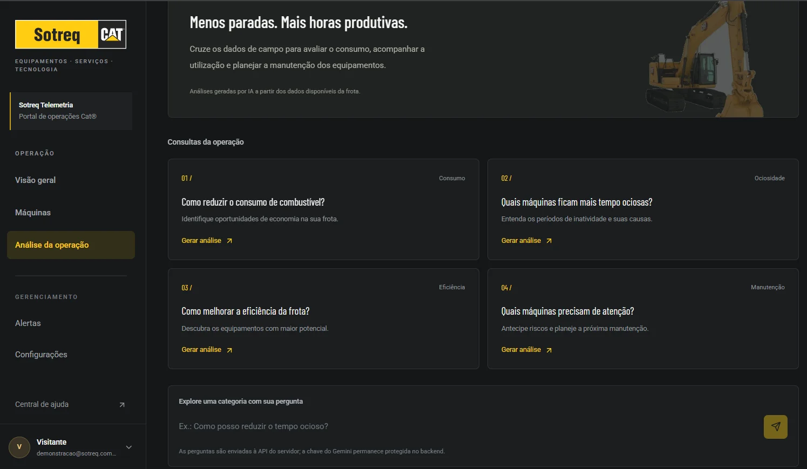
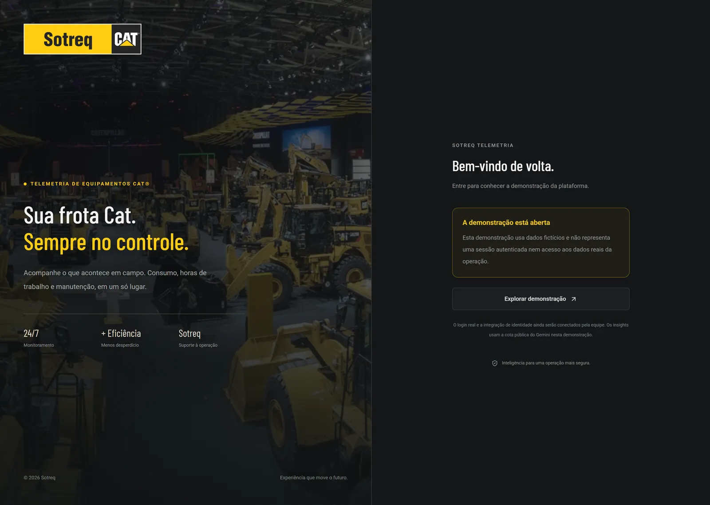
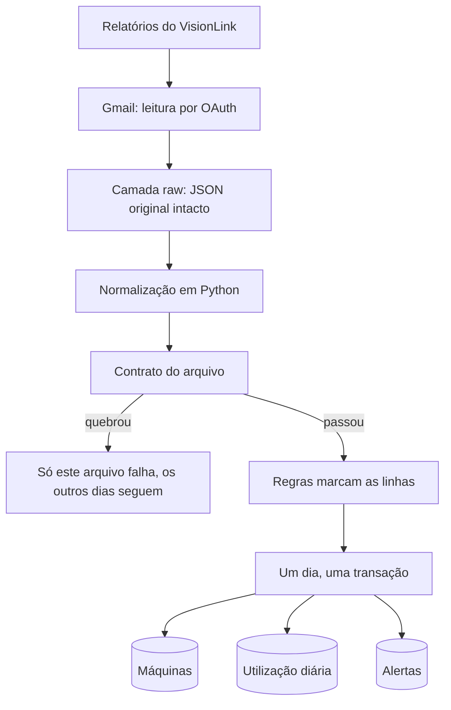

## Problema

Um cliente com frota mista, de Caterpillar e outras marcas, não tem uma visão única de consumo de combustível, ociosidade e deslocamento das máquinas. Os dados ficam em um site por fabricante, e acompanhar a frota significa abrir um por um.

## Solução

Uma aplicação web em React e Vite que consolida a telemetria. Os relatórios agendados do VisionLink chegam todo dia a um e-mail dedicado, e um pipeline em Python os lê, padroniza, valida e grava em um banco PostgreSQL, no Supabase. A aplicação lê o banco, e a API do Gemini devolve insights sobre o que melhorar na frota.

**O que foi meu:** o pipeline de dados, da extração à gravação diária no banco, passando por normalização e qualidade.

**Análises do painel:** defini as 10 análises que o painel mostra, de ociosidade e custo do combustível ocioso às próximas revisões. Para cada uma, escrevi a regra, a fonte e o gráfico, e conferi as contas com os dados reais em pandas e em um protótipo em HTML, que serve de referência para quem faz as telas. Duas regras valem para todas: vazio não é zero, porque hora vazia quer dizer que o dado não chegou, e o percentual de um grupo se calcula somando antes de dividir, nunca pela média dos percentuais.

**Integração com o Gemini:** como tutor do squad, dei a ideia e acompanhei de perto cada passo. A implementação foi de outra pessoa do time, sob a minha tutoria.

Tela de análises com o Gemini, implementada por outra pessoa do time, sob a minha tutoria. Demonstração com dados fictícios.

Entrada da demonstração, que avisa na própria tela que os dados são fictícios.

## Arquitetura

O diagrama mostra o pipeline, que é a minha parte. As tabelas ficam no PostgreSQL do Supabase. As views que calculam os indicadores e a aplicação web com o Gemini são de outras pessoas do time.

**O dado original nunca é alterado.** Como a camada raw guarda o JSON como ele chegou, qualquer dia pode ser reprocessado quando uma regra muda.

## Decisões técnicas

**Ingestão por e-mail agendado, em vez de API.** O acesso às APIs dos fabricantes é difícil e não estava disponível. O relatório agendado resolve a entrada de dados sem depender desse acesso. O custo é ficar preso ao formato e à frequência dos relatórios.

**Gravação pronta antes de o banco existir.** Esperar as tabelas travaria a coleta, e dia não coletado é histórico perdido. O pipeline gravou em Parquet, que preserva o tipo de cada coluna, enquanto a gravação no PostgreSQL era escrita atrás da mesma interface. Quando o banco ficou pronto, a troca foi uma variável de ambiente, e o histórico inteiro entrou na primeira carga. O custo foi escrever essa gravação sem um banco real para testar.

**Reprocessar o histórico a cada execução.** Gravar um dia substitui o arquivo daquele dia, então rodar duas vezes dá o mesmo resultado que rodar uma. Assim, uma regra nova corrige todo o passado. O custo é o tempo crescer junto com o histórico.

**Máquina parada não é aparelho mudo.** Na primeira carga no banco, um aviso de máquina sem leitura disparou 238 vezes em 45 dias, e 186 eram máquinas estacionadas com o aparelho funcionando. O aviso passou a olhar o status do aparelho, e o painel mostra as duas situações com nomes diferentes: a parada está disponível e sem serviço, e a muda precisa de alguém para ver o aparelho. O custo é o aviso depender de um texto que vem no idioma da conta do VisionLink.

**Contrato para o arquivo, regra para a linha.** Um problema de formato, como unidade de tempo errada ou chave repetida, reprova o arquivo inteiro, sem atrapalhar os outros dias. Um valor estranho não descarta nada: a linha é gravada e marcada. A marcação tem três valores, porque "vazio" quer dizer que faltou dado para comparar, o que é diferente de "está certo". O custo é quem analisa precisar levar as marcações em conta.

**Custo zero como requisito.** A solução precisava funcionar sem gasto de infraestrutura.

**Base pensada para replicar.** A estrutura foi desenhada para servir a outros clientes, e não só a este.

## O que eu aprendi

**O caminho inteiro de um pipeline.** Passei por extração, entendimento dos dados, normalização, qualidade e análise.

**Usar IA para aprender, não para copiar.** Comecei com uma regra: a IA explicava, e eu escrevia o código. Foi assim que fiz a leitura do relatório e a normalização. Na reta final, com o prazo apertado, abri uma exceção e a IA escreveu o restante, com cada decisão documentada.

**Trabalhar com frentes separadas.** Foi meu primeiro projeto em grupo com uma divisão clara de atividades.
